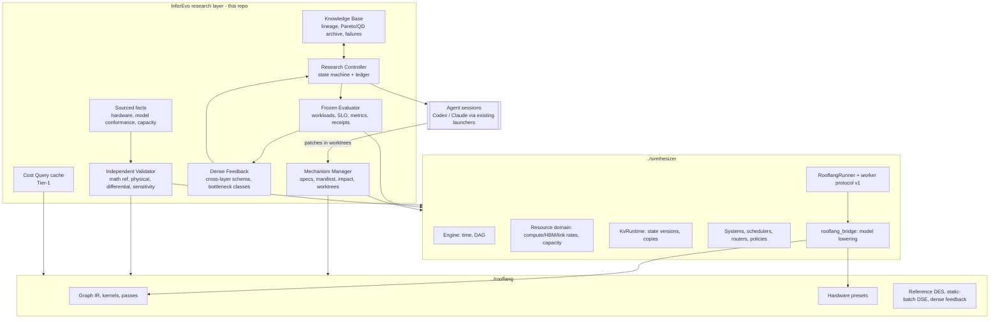
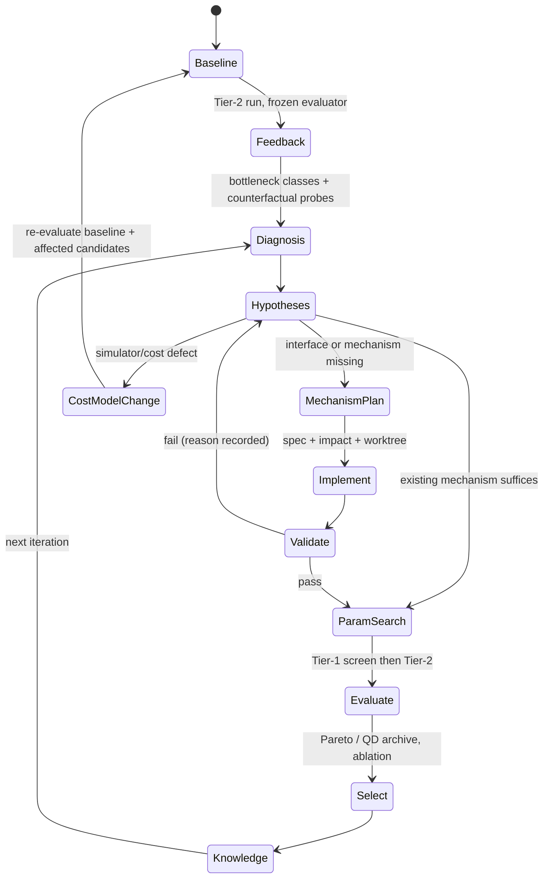

# InferEvo Architecture

Agent-driven explorer of LLM inference architectures, built on Simthesizer
(system DES) and RoofLang (operator/hardware cost). Long-term goals and
constraints: `RESEARCH_SPEC.md`. Rationale: `DECISIONS.md`. Source audit:
`REFERENCE_ANALYSIS.md`. This file describes structure, not status
(`PROGRESS.md`).

## 1. Layers and ownership



| Concern | Single owner |
|---|---|
| Virtual time | Simthesizer engine |
| Compute/HBM/link rates, contention, capacity reservation | Simthesizer resource domain |
| KV / recurrent-state identity, versions, copies, release | Simthesizer `KvRuntime` |
| Token progress, batching | Scheduler (or validated policy) |
| Request lifecycle, P/D routing, agent DAG release | Simthesizer systems |
| Operator semantics, FLOPs by dtype, bytes, tensor layout, placement, transfer bytes/routes | RoofLang (via bridge lowering) |
| Hardware graph and peak rates | RoofLang presets (audited against InferEvo facts) |
| What to analyse / change / search next | Agent + controller |
| Correctness, feasibility, receipts | InferEvo validator + evaluator (outside candidates) |

Charge rule: each cost has exactly one owner; nothing is timed twice (D4).

## 2. Execution contract

The contract is Simthesizer's worker protocol v1, made explicit:

- **Request** (Rust → worker): stage, per-request `(q_len, kv_len,
  lm_head_len)`, request identities, layout (attn TP/DP groups, EP,
  instance, GPU ids), routing seed.
- **Response** (worker → Rust): work templates (per-resource service seconds
  at full rate + setup latency, stream slots, memory reserve/release),
  operation rows (parents, template, layer, KV rank, batch rows, state access).
- **State**: `state_layers` schema (fixed vs growing, replicated vs sharded)
  checked against native accounting; state reads/writes bound to KvRuntime.

Two granularities (D3):

| Tier | Unit | Owner | Use |
|---|---|---|---|
| Tier-2 Execution DAG | operator / transfer node | shared path | new mechanisms, contention, final evaluation |
| Tier-1 Cost Query | iteration (aggregates) | RoofLang + memo cache keyed by cost-model hash | screening, large parameter search |

Tier-1 results never enter final evaluation; a promoted candidate is always
re-evaluated at Tier-2.

## 3. Research loop



Candidate states (reused from `simthesizer/agents/qwen_moe_optimization`):
`DRAFT → CHECKING → EVALUATING → REPLAYING → VERIFIED | FAILED | EXPLORATORY`.
Only the controller/evaluator writes state transitions and receipts.

Search levels (spec 7.2): parameter → combination → policy → mechanism →
architecture. Level-1 uses classical DSE (grid/NSGA-II/BO over Tier-1);
levels ≥3 change the design space itself (new variables registered by the
mechanism spec).

## 4. Mechanism extension

A mechanism spec (machine-readable, `mechanisms/<id>/spec.yaml`) states:
parent, bottleneck evidence, hypothesis, components added/modified/reused,
interface/state changes, new design variables, resource and semantic
constraints, failure modes, validation plan, rollback. Extension points, in
preference order:

1. Policy program (route/batch/KV submission) — no core change.
2. New registered Simthesizer `kind` (system, scheduler, router, runner).
3. New bridge lowering / RoofLang kernel or pass (model-side mechanism).
4. Engine/resource/KvRuntime change — allowed, with full impact closure and
   regression.

Impact analysis uses the component manifest (D7); candidates live on
worktree branches (D8); the stable baseline is never overwritten.

## 5. Validation and credibility

Independent of the optimizing agent:

- Math: small CPU reference (numpy) for new graph/layout/parallel mechanisms.
- Physical: capacity per device, precision support per architecture,
  topology/route existence, byte and FLOP conservation, resource release.
- Engine: existing runtime checks (KV readiness, drain, stream exclusion).
- Differential: Tier-2 isolated round vs RoofLang reference DES; Tier-1 vs Tier-2.
- Regression: tests in the impact closure + frozen baselines.
- Sensitivity: sweep efficiency, bandwidth, α, overlap, buffer knobs within
  sourced bands; promotion requires gain across the band (D11).

## 6. Code map

See `AGENTS.md` for directory ownership. Key modules:

```text
adapters/engines.py         engine locations, source identity, bridge imports
adapters/cost_model.py      cost-model version, vendored drift, preset access, roofline ratios
validation/hardware.py      sourced H200/B300 facts, preset audit (emulation-aware)
validation/kimi_conformance.py  official config/checkpoint vs model
validation/capacity.py      resident-memory feasibility sweep
validation/sources/         official source snapshots
mechanisms/isolation.py     baseline snapshots, candidate worktrees, version records
engines/{simthesizer,rooflang}  active engine branches
```
